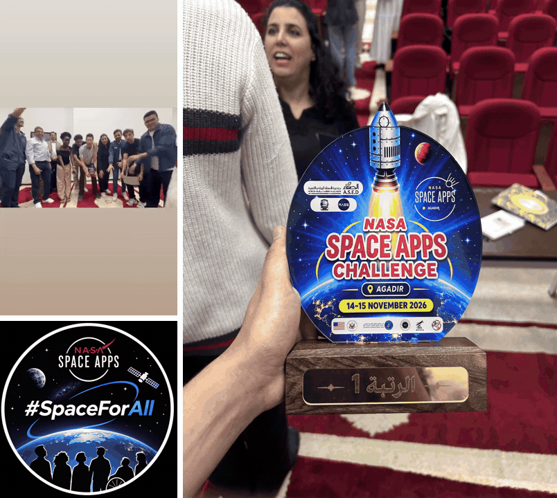
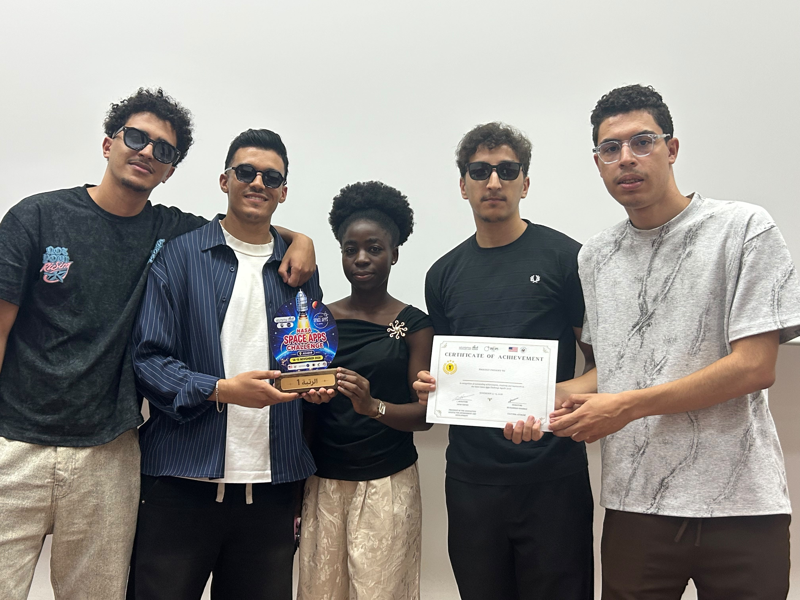
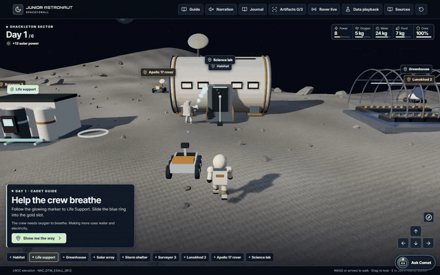
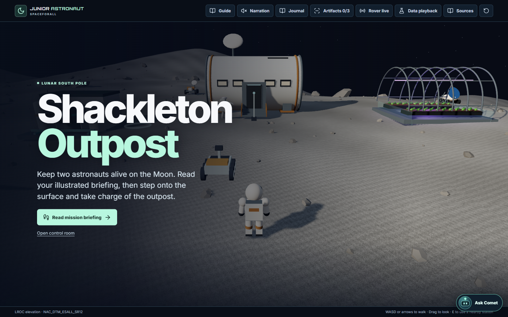
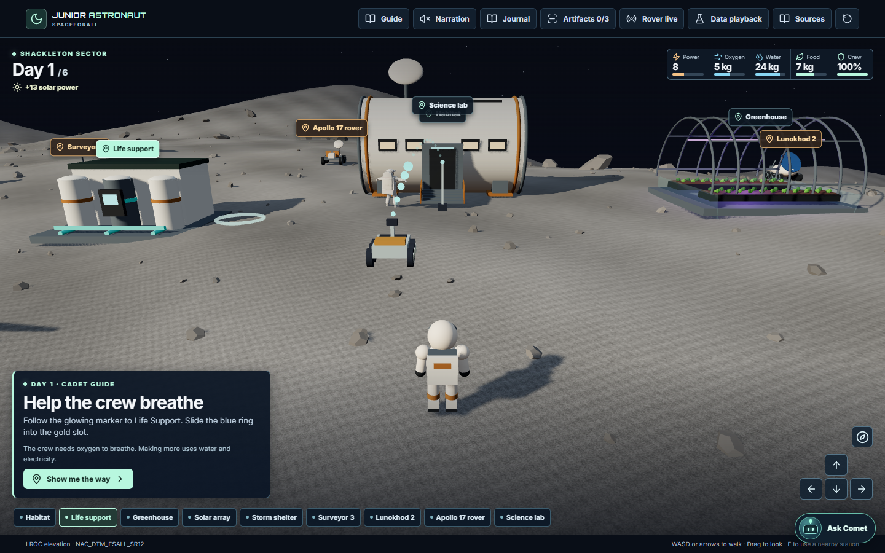
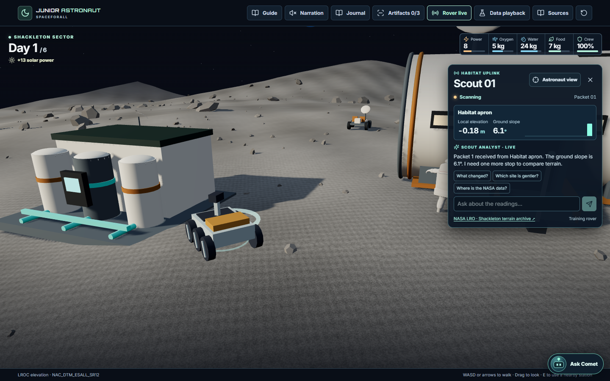
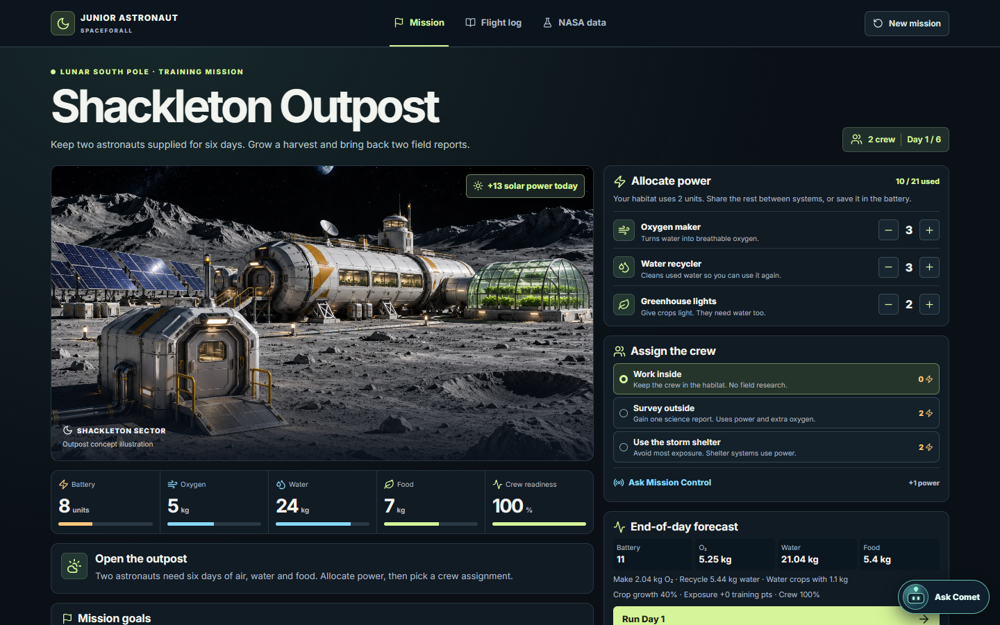
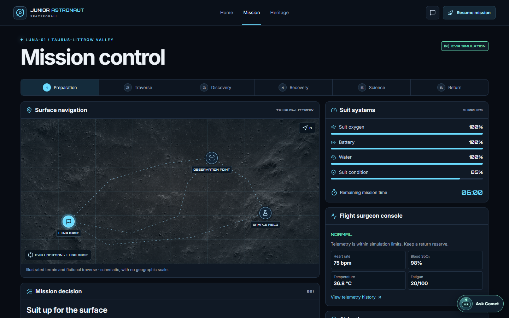
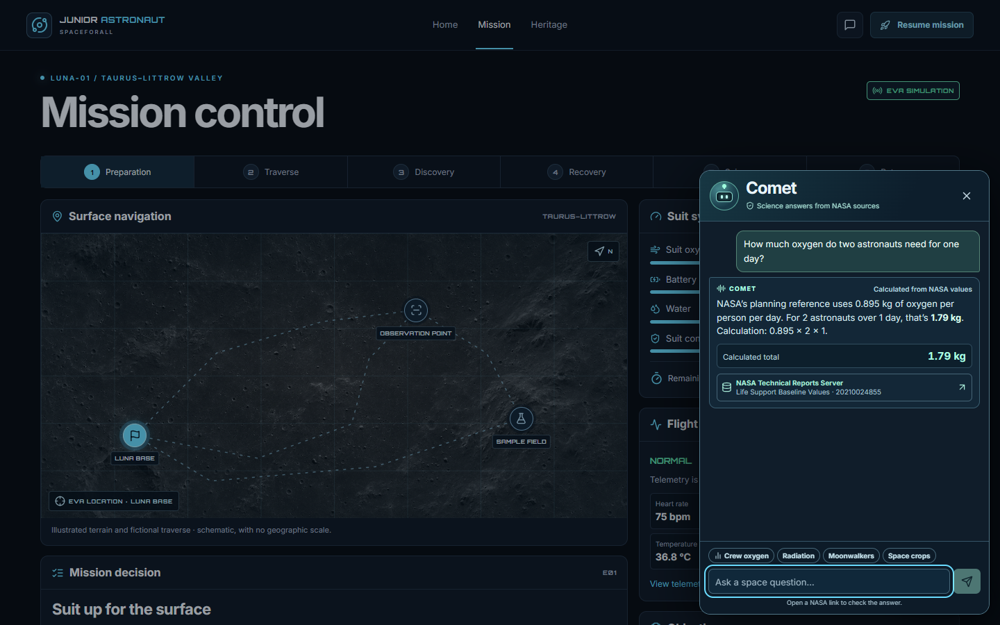

# Junior Astronaut

**FIRST PLACE — NASA Space Apps Challenge 2026, Agadir, Morocco**

Built by **Team SpaceForAll**, Junior Astronaut helps children aged **7–12** discover lunar exploration through interactive missions, scientific activities, teamwork, and resource management.

## Video and event highlights

## Application demo

A 15-second recording of the running application: moonwalking, following Scout 01, and opening the outpost resource dashboard.

[Watch the 15-second app demo](Nasa/junior-astronaut-demo-15s.mp4)

### Screenshots

Captured directly from the running application.

| Lunar outpost | Moonwalk and cadet guidance |
| --- | --- |
|  |  |

| Scout 01 rover exploration | Six-day resource management |
| --- | --- |
|  |  |

| LUNA-01 mission control | Comet scientific assistant |
| --- | --- |
|  |  |

## From idea to application

We turned the idea of learning through lunar mission decisions into a completed application where children explore, solve problems, and see how their choices affect a mission and its crew.

- **LUNA-01:** A lunar surface mission with route choices, oxygen management, historical discoveries, sample collection, and safe-return decisions.
- **Shackleton Outpost:** A six-day simulation covering power, water, oxygen, plant growth, and crew assignments.
- **Interactive 3D exploration:** A walkable lunar environment with equipment activities, scientific stations, and rover exploration.
- **Guided learning:** Educational storytelling, step-by-step instructions, scientific visualizations, and a quiz.
- **Comet:** A local, rule-based assistant that answers questions using curated scientific references.

## Science and gameplay

NASA mission archives, technical reports, plant research, radiation measurements, and lunar terrain data inform the educational content. Scientific references and historical facts are distinguished from fictional mission scenarios, simplified resource rules, and gameplay outcomes.

## Built with

**React** and **TypeScript** power the interface, with **Three.js** rendering the lunar environment. **Python** powers the LUNA-01 simulation through **FastAPI** in server mode or **Pyodide** in the browser for the portable demo.
